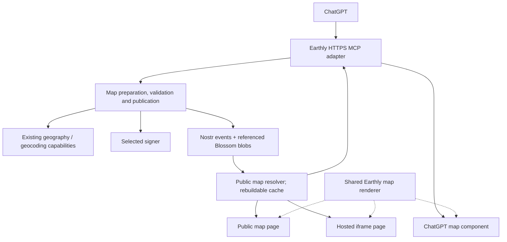

# Earthly public map plugin: architecture and roadmap

Architecture and implementation notes · updated 11 October 2026

This document records product decisions and proposed implementation boundaries. An initial local implementation now exists on `codex/public-map-plugin`; see [runtime setup and limits](../src/map-plugin/README.md). It implements inline-data preview, public Nostr publication, a shared viewer, and configured iframes, with desktop/mobile MCP sandbox tests. Hosted ChatGPT verification, blob-backed maps, and connected-user signing remain open. No deployment or change to the active GSD roadmap is included.

## 1. Agreed first release

**Turn information into a map → see it in the conversation → share a public link → request a configured iframe.**

The user has selected public maps as the first release and explicitly deferred Napplet complexity. These are settled scope decisions.

- Inputs may come from the conversation, research, files, other tools, existing Nostr maps, or generated geometry. A spreadsheet is one source, not the product model.
- Start with one dataset containing points, lines, and polygons, with supported Earthly styles, callouts, and attribution.
- Render it in ChatGPT, on a public Earthly page, and in a hosted website iframe.
- Recipients should be able to view public maps without ChatGPT or an Earthly account.
- Durable map content remains in Earthly's Nostr event formats and referenced Blossom blobs. No separate authoritative plugin map database.
- A working preview may be temporary. A request to visualize information does not alone authorize public publication. A clear request to publish/share publicly supplies that intent without an additional ritual confirmation.
- Napplets, web-component packaging, PDF export, private collaboration, and delivery optimization are deferred. None is a dependency of this release.

Candidate directory description: **Create interactive maps from your conversation. Share a public link or embed them on your website.**

## 2. Similar plugin descriptions

This is a description review, not hands-on testing. Sources are the user's five plugin-directory screenshots and directory search results retrieved on 11 October 2026. Search did not return several geographic plugins visible in the screenshots, including exact-name searches for MAIA and Mapbox. That is a discovery limitation, not evidence that those plugins are unavailable. More entries may be visible in the [plugin directory](https://chatgpt.com/plugins).

| Plugin in screenshots | Description | Relevance |
| --- | --- | --- |
| GIS Cloud | Create maps and GIS analysis | Closest broad authoring positioning. Inline display, sharing, and iframe generation are not established by this description. |
| AI Trip Planner | Create rich, custom maps | Closest custom-map promise, presented through travel. Arbitrary-source support and embeds are not established. |
| Mapbox | Location Intelligence | Relevant geographic platform, but the description is too broad to establish an authoring workflow. |
| MAIA | Geospatial research engine | Relevant research/analysis positioning; portable outputs are unspecified. |
| BigGeo AI | Spatial Intelligence for LLMs | Relevant AI/geography boundary; rendering and sharing are unspecified. |
| GeoAI Skills | Measured geospatial workflows | Relevant agent workflow positioning; output behavior is unspecified. |
| MapQuest / AnywhereMap - Navigate+Locate | Find places and get directions / Find/Explore Places+Locations | Place discovery and navigation overlap; less direct evidence of arbitrary map authoring. |
| Badger Maps (Advanced) / MyGeotab MCP | Build optimized routes / Analyze and manage your fleet | Useful delivery-workflow comparisons, outside this release. |
| Xweather, Trains on Map, TapWaterMap, The Wildfire tracker | Weather, train, water-quality, and fire descriptions | Maps focused on a source or subject, without a stated general authoring workflow. |

GIS Cloud, AI Trip Planner, and MAIA appear in screenshot 3; Mapbox and MapQuest in screenshot 1; BigGeo AI and GeoAI Skills in screenshot 5. Many other results concern mind maps, code maps, or SEO/GEO rather than geography.

Additional patterns from retrieved directory descriptions:

| Plugin | Explicitly advertised behavior | Lesson |
| --- | --- | --- |
| Tripadvisor | Interactive hotel maps within ChatGPT, refined through conversational follow-ups | Conversational map interaction; general authoring and embeds are not established. |
| Whimsical | Generate visual content from the conversation, update with prompts, then open the product to edit/share/collaborate | Closest adjacent create → refine → share pattern, with whiteboards. |
| MindMap | Interactive mind maps in ChatGPT with pan/zoom, fullscreen, and node explanations | Interaction precedent, not a geographic competitor. |
| MotherDuck | Natural-language data exploration and saved, shareable interactive visualizations | Turning an answer into a reusable artifact. |

Directory identifiers: Tripadvisor `app-69050bf6de9c8191b3968f2cc08d33d6`; Whimsical `app-69c6561277188191a1beac515a4b2ea4`; MindMap `app-69e1ea6c505c81918d6c8f0258a64906`; MotherDuck `motherduck`. These are provider descriptions, not verified behavior. No plugins were installed or invoked.

**Finding:** similar ideas exist at the authoring, conversational-map, and shareable-visualization levels. None of the descriptions reviewed explicitly establishes the entire arbitrary-input → geographic map in chat → public link → configured website iframe workflow. This is a hypothesis worth testing, not a claim that no competitor offers it.

Earthly's opportunity is the completeness and ease of that workflow. Nostr supplies portable content and independent reading underneath it; users should experience a useful map without first learning the protocol.

## 3. Concrete user stories

1. **Create:** “Put the places we just discussed on a map, colored by category.” Accept prepared records or geometry; geocode when necessary; flag ambiguous locations; return an interactive preview.
2. **Refine:** “Remove that location, rename this one, and zoom to the remaining places.” Retain stable feature IDs and apply the intended changes.
3. **Share:** “Publish this as a public map and give me a link.” Sign and publish the selected content, check relay acceptance, and return a public viewer URL plus a portable Nostr reference.
4. **Embed:** “Also give me an iframe, with a dark theme and no legend.” Return a configured viewer URL and copyable HTML for the same dataset.
5. **Reuse:** A recipient opens the link; a developer pastes the iframe into a page. Both see the map without joining the creator's conversation or connecting a signer.

These stories fit public project locations, cited research, event venues, historical journeys, geographic examples generated by ChatGPT, and existing public Nostr datasets. Separate product pipelines for each source are unnecessary.

## 4. Architecture for the first workflow

These are logical responsibilities, not mandatory deployment boundaries. Publication includes blob upload, signing the referencing event, and relay acknowledgement. The resolver can be a shared module with a hosted endpoint where needed; its cache is derived from public references.

| Part | Responsibility |
| --- | --- |
| ChatGPT | Interpret intent and sources; propose content; explain uncertainty and results. |
| Earthly operations | Normalize and validate data, invoke real geocoding where necessary, preserve Earthly semantics, and report publication outcomes. |
| Signer | Sign for the explicitly selected author under the chosen custody model. |
| Nostr ecosystem | Hold published events and referenced geometry blobs. |
| Shared renderer | Display geometry, styling, callouts, attribution, legend, and camera consistently. |
| Host adapters | Connect the renderer to ChatGPT, a standalone page, or a website iframe. |

This does not require another general-purpose AI agent inside Earthly. An iframe does not need an AI service to display a map. ChatGPT calls domain tools; the viewer renders their results. Existing ContextVM capabilities can supply geography operations, with an HTTPS MCP adapter for ChatGPT. Duplicating every UI action as a server tool is unnecessary.

For ChatGPT, package the renderer as an MCP App component. For websites, mount it on a hosted embed route. They share rendering code; the ChatGPT component need not load the website iframe inside another iframe.

OpenAI documents inline components, fullscreen maps, host messaging, and resource-domain declarations. Map assets and connections must work within that sandbox. Selection context must be sent through the bridge if the model should use it; visibility on screen does not automatically become model context. Test the actual Earthly renderer, including small screens. See the [UI guide](https://developers.openai.com/plugins/build/chatgpt-ui).

## 5. Headless value and candidate tools

An agent plus `nak` can already construct and publish a simple geographic event. Earthly earns its interface by reliably turning it into a usable, shareable, embeddable map while preserving the existing data model.

| Capability | Candidate tool | Behavior worth owning |
| --- | --- | --- |
| Prepare and preview | `preview_map` | Accept supplied records/GeoJSON or revise a scoped draft; validate; retain IDs/styles/sources; return warnings and renderer input. |
| Read a saved map | `read_map` | Resolve references, verify events and blobs, and supply bounded content and presentation metadata. |
| Publish publicly | `publish_map` | Internally prepare an exact plan, sign or accept a matching signed event, publish idempotently, and report accepted relays and references. |
| Produce an embed | `get_map_embed` | Validate supported view options and return the embed URL and HTML. Hiding a legend does not require new publication. |

Names and granularity are provisional. Separate data operations from rendering responses where that avoids repeated component remounts. Broad map discovery and a general export framework are not prerequisites.

Return stable references and bounded summaries; use appropriate data delivery for large feature sets instead of repeatedly passing them through the model. Draft handles are temporary, caller-scoped state, never durable map addresses. Preview hydration must not secretly upload data to public storage.

Publication binds the author and reviewed content to signing. Retries reuse the same signed event. Updates preserve dataset identity and detect observed revision conflicts. Nostr does not provide a global compare-and-swap transaction across relays; do not promise one.

## 6. Sharing, iframe configuration, and persistence

A public URL carries a portable map reference, with relay hints where appropriate. A friendly path must not depend on a proprietary slug database as its sole meaning. An embed uses the same reference plus bounded view settings.

Proposed initial options:

- Light/dark theme from supported basemap presets.
- Initial camera or fit-to-data.
- Show/hide title, legend, and supported controls.
- Enable/disable scroll zoom.
- Width and height on the iframe element.

Attribution remains visible as required. Dataset colors, labels, and callouts belong to the saved map's supported presentation data; embed options customize the surrounding view. This avoids competing definitions of the map.

**Configured** means ChatGPT returns an iframe already set up from the request. **Configurable** means the supported options can be changed through documented URL parameters, another prompt, and eventually a small configuration panel. Start with prompts and parameters; a visual configurator is an enhancement.

Version and validate the configuration schema. Arbitrary JavaScript/HTML, entire datasets, and signing credentials do not belong in configuration URLs. Hidden labels or display filters are not access control over public data.

Proposed initial link behavior: follow the latest published version at the map's Nostr address on load. Continuous live refresh is separate, not implied. Immutable snapshots can follow later: an event ID alone does not guarantee older revisions remain retrievable from relays that retain only the latest addressable event.

Operational sessions, temporary drafts, credentials, and rebuildable caches are distinct from durable map content. After deleting the content cache, a fresh client should reconstruct a saved map from its reference and declared relay/blob dependencies. Availability still depends on those services retaining and serving the content.

## 7. Signing: remaining product choice

Public readers and iframe consumers need no private key. The authoring runtime needs a signer to publish or update.

- **Connected user signer:** a browser/local signer or explicitly connected remote signer owns publication. Strong continuity for existing Nostr users, with onboarding friction for others.
- **Guest map identity:** generate a fresh key per map in a signing runtime. The server may hold it for a defined editing session in a low-friction pilot. Session loss or key expiry means that identity cannot update the original address unless recovery was provided. Public reading continues while the events/blobs remain available.

The initial implementation uses a guest key per map as a pilot default, not a finalized custody or retention policy. Keys stay in memory for the MCP editing session, up to two hours, and are lost on termination or restart. “Come back next week and edit this map” would require persistent credential storage or a connected/recoverable signer. ChatGPT authentication and Nostr signing are separate concerns.

The ContextVM transport key must not silently become everyone's publishing identity. Keys never enter chat, ordinary tool results, viewer configuration, or share links. Per-map guest keys isolate authority without requiring a general account system.

Copying a guest map into a user's identity creates a new Nostr address with provenance; it does not transfer the old address. Publication success requires actual relay acknowledgement, not merely local signing or attempted transmission.

## 8. Roadmap: one complete first release

These are increments toward one release, not calendar estimates.

| Increment | Deliverable | Completion gate |
| --- | --- | --- |
| **1. Map in chat** | Focused renderer, temporary normalized input, basic styling/callouts, MCP App adapter; extract only needed domain code. | Generated points, a line, and a polygon render in the actual host. Follow-up changes target the intended features. Invalid/ambiguous inputs are reported. |
| **2. Publish and share** | Select signer policy; reuse event publication/blob handling; add public reader page. | Publish → acknowledged relays → URL → recipient opens without an account. Fresh-client reconstruction succeeds after clearing caches. Retries preserve the signed event. |
| **3. Give me an iframe** | Shared renderer on a hosted embed route; bounded configuration; ready-to-paste HTML. | A minimal external page loads the iframe without ChatGPT state or creator credentials. Content matches the other views, settings work, and attribution remains. |
| **4. Complete the pilot** | Loading/missing-data/errors, responsive sizing, source ambiguity, supported size/geometry/service limits; package and test. | Several arbitrary-source examples complete create → refine → publish → share → embed. Failed publication never becomes a success message. |

No Napplet host spike, new encryption profile, fleet optimizer, broad UI-to-tool mirror, or PDF pipeline is a prerequisite. Reuse geographic tools when a story needs them. Batch geocoding can follow the first coordinate/generated-geometry slice within the pilot.

Small evaluation set: generated equator line; mixed public locations with one ambiguous name; styled polygon; supported blob-backed dataset; follow-up edit to a published map. Fresh-reader portability matters more than an extensive benchmark before the flow is usable.

Implementation experiments must use loopback relays and existing AI-suite tasks. Read `ai-suite/README.md` and run `bun run ai:list` before browser automation. The implementation adds an opt-in AI Suite scenario for desktop/mobile preview, sandbox messaging, publication, sharing, and embedding against a disposable local relay. Actual hosted ChatGPT conformance remains unverified.

## 9. Existing code to build on

| Existing implementation | Reuse implication |
| --- | --- |
| `src/lib/nostr/geo-event/factory.ts` | Kind-37515 create/update semantics and metadata/blob references. Review application-runtime dependencies before headless use. |
| `src/lib/nostr/publishCommit.ts`, `publishAcknowledgement.ts` | Preserve commitment guard and accepted-relay requirement in hosted execution. |
| `src/features/geo-editor/api/authoring.ts` | Geometry normalization/authoring; some metadata still falls back to the editor store. |
| `src/features/chat/tools/executionTarget.ts` | Detached editing exists, but editor-store persistence and module-level state are not an isolated multi-user server runtime. |
| `src/features/webmcp/` | Revision checks, prepared publication, scoped authority, and schemas. Browser registration needs a hosted adapter. |
| `contextvm/` | Geography, research, geocoding, routing, and blob capabilities to compose/reuse. |

The initial extraction moves `GeoDatasetFactory` into a headless `datasetFactory.ts` module and preserves the existing `factory.ts` exports. The new viewer reuses Earthly's feature-layer builder, while the MCP adapter reuses the Nominatim adapter and publication-acknowledgement check.

## 10. Deferred directions

- **Napplets / web components:** revisit when a consumer needs a portable artifact or direct component integration. Maplets are a specialized Napplet flavor; the full upstream spec remains the reference when this resumes.
- **PDF/images:** derive from the same resolved map and presentation model when prioritized.
- **Private maps:** reuse existing MLS/Cordn groups first. Cordn stores opaque ordered records; clients retain MLS state. Hosted plaintext processing is a separate trust decision. Multi-recipient encrypted envelopes are possible, but not already an Earthly private-map profile.
- **Delivery planning:** routing an ordered list is distinct from optimizing vehicles, capacities, or time windows. The public-map pilot does not promise the latter.
- **Snapshots / composition:** define historical retention before promising immutable links; add Stories/Atlases when demonstrated need warrants them.

Signing custody/recovery still needs a launch decision. The local implementation uses temporary guest keys, latest-on-load links, and prompt-configured iframe options; it does not promise recoverable editing authority.

## Sources

- User-provided plugin-directory screenshots 1–5 and directory descriptions retrieved 11 October 2026; [plugin directory](https://chatgpt.com/plugins). Search is not exhaustive and descriptions are not functional verification.
- Repository: [Earthly event specification](../SPEC.md), [architecture overview](./architecture/overview.md), [WebMCP](./architecture/webmcp.md), [ContextVM service](../contextvm/README.md), [private collaboration](./architecture/private-collaboration.md), [Maplets](./maplets.md).
- [OpenAI UI guide](https://developers.openai.com/plugins/build/chatgpt-ui): MCP Apps, display modes, model context, resource policy. [MCP server guide](https://developers.openai.com/plugins/build/mcp-server): structured results and useful tools without UI.
- [NIP-01](https://github.com/nostr-protocol/nips/blob/master/01.md): addressing/replacement. [NIP-46](https://github.com/nostr-protocol/nips/blob/master/46.md): remote signing. [NIP-59](https://github.com/nostr-protocol/nips/blob/master/59.md): individual encrypted recipient envelopes.
- Deferred Napplet references: [registry](https://github.com/napplet/naps), [SDK](https://github.com/napplet/web).
