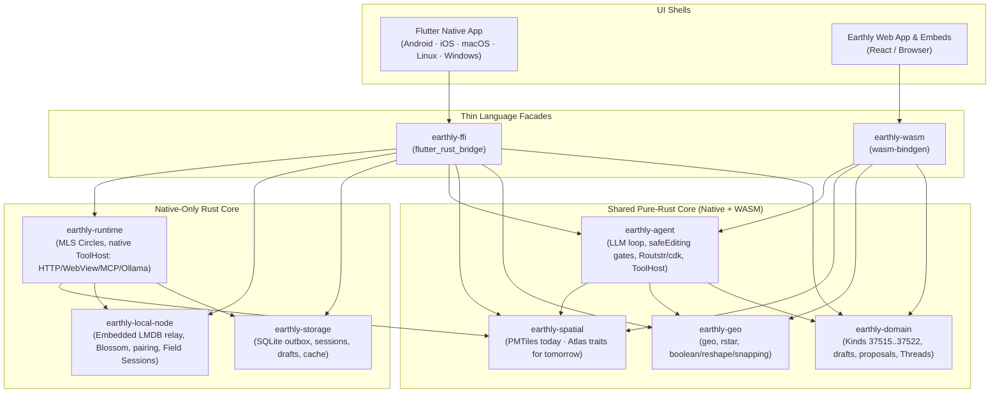

# Earthly Native Rewrite Architecture

Status: **working architecture RFC**, 2026-11-25  
Scope: Replacing the Tauri WebView shell with a native **Flutter + Rust (+ WASM)** architecture across Android, future iOS, and Desktop (macOS / Linux / Windows), while keeping the web app (`earthly.city`) converged on the same Rust core.

---

## 1. Why We Are Ditching Tauri

Earthly's Tauri v2 effort validated the hard systems layer—an embedded Nostr relay (`nostr-lmdb`), a local Blossom HTTP server (`axum`), signed peer pairing, Field Sessions, and a crash-safe SQLite publish outbox—all already written in Rust ([`crates/earthly-local-node`](../crates/earthly-local-node/Cargo.toml) and [`src-tauri/src/`](../src-tauri/src/lib.rs)).

The bottleneck is **not** the Rust backend; it is the **WebView UI projection**, especially on Android:

- System WebView overhead, JS main-thread contention, and WebGL MapLibre GL JS performance lag behind native GPU rendering.
- Touch gestures, interactive vertex editing, bottom sheets, and background lifecycles feel fragile through a WebView bridge.
- Maintaining a WebView-bound IPC boundary blocks native-only capabilities (in-app interactive/headless web browsing for AI research, hardware sensors, smooth native media capture, unconstrained local compute).

**Core rule of the rewrite:** keep and expand the Rust core, extract all non-Tauri logic out of `src-tauri/`, and replace only the UI shell with a true native frontend.

---

## 2. Strategic Technical Decisions

| Decision | Choice | Rationale |
| :--- | :--- | :--- |
| **Native UI stack** | **One Flutter codebase** (Android first, iOS-ready, Desktop macOS/Linux/Windows) | Impeller GPU rendering, ~90%+ UI reuse across mobile and desktop, mature `flutter_rust_bridge` v2, native OS plugins (ForegroundService, NIP-55 Amber, Keystore/Keychain, WebView, Camera/GPS). Desktop can be extracted later if needed, without throwing away the Rust core. |
| **Map rendering** | **MapLibre Native** (spike existing Flutter bindings first; custom GPU `Texture` bridge if touch latency or Desktop MapLibre is insufficient) | Rendering MapLibre Native C++ into a Flutter GPU `Texture` (`SurfaceTexture` / `CVPixelBuffer` / OpenGL-Vulkan) lets Flutter own 100% of gesture recognition, callouts, glass panels, amber proposal ghosts, and vertex handles at 60/120fps across every OS. |
| **Domain, Geometry & AI Engine** | **Shared Rust Core + WASM** | Moves geometry operations (`geo` crate), Earthly Nostr domain models, and the AI agent runtime into Rust—compiled natively for Flutter and to `wasm32-unknown-unknown` for the Web app. Eliminates maintaining two parallel TS/Dart engines. |
| **Basemaps & World Data** | **Sunset Mapnolia discovery; keep PMTiles; prepare for [`zeSchlausKwab/atlas`](https://github.com/zeSchlausKwab/atlas)** | Do not port `saved_regions.rs`'s Mapnolia kind-34444 chunk planner. Keep clean local/remote PMTiles support today behind trait boundaries designed around `.atlas` capabilities (vector rendering, offline routing/isochrones, local AI task workspaces, Hashtree/FIPS area acquisition). |
| **Sovereign Transport** | **FIPS-ready from Day 1** (inspired by [`zeSchlausKwab/atlas`](https://github.com/zeSchlausKwab/atlas) native FIPS and [`fr34aky/fips2go`](https://github.com/fr34aky/fips2go)) | Out of scope for Phase 0–2 delivery, but `earthly-local-node` supports dual-stack IPv6 ULA (`fd00::/8`), `.fips` hostnames, and pluggable peer transports so Field Sessions, Circles, and Basecamp syncing can seamlessly run over FIPS mesh later. |

---

## 3. Target Rust Workspace Architecture (`Native + WASM`)

Every non-UI subsystem lives in a single Cargo workspace. Pure-logic crates target both native platforms and `wasm32-unknown-unknown`.

### Crate Responsibilities

1. **`crates/earthly-local-node`** *(existing, upgraded in Phase 0)*  
   Reusable embedded Nostr relay (`nostr-lmdb`), BUD-01/02/11 Blossom server (`axum`), signed pairing, Field Sessions, NIP-77 sync, and dual-stack Loopback / LAN / `FipsMesh` endpoint policies.
2. **`crates/earthly-storage`** *(extracted from `src-tauri/` in Phase 0)*  
   Tauri-independent SQLite persistence: durable signed-event publish outbox (`OutboxStore`), account sessions (`AccountSessionStore`), and later local drafts, Threads, and cached event indexes.
3. **`crates/earthly-spatial`** *(introduced in Phase 0; native + WASM)*  
   Decouples Earthly from Mapnolia while supporting PMTiles today and [`zeSchlausKwab/atlas`](https://github.com/zeSchlausKwab/atlas) tomorrow across four explicit capability seams:
   - `TileSource` — tile/archive reading & metadata (local/remote PMTiles v3 today; `.atlas` vector/raster sources later).
   - `SpatialWorkspaceProvider` — aligns directly with Atlas's task-local AI workspace contract (`catalog`, `prepare`, `query`, `result_page`, `release`) with bounded geographic scope, explicit data families (`locations`, `buildings`, `objects`), and `complete`/`partial` coverage provenance.
   - `RoutingProvider` — walking/cycling/driving routes and network isochrones (remote ContextVM/Valhalla today; local `.atlas` routing engine tomorrow).
   - `AreaAcquisitionProvider` — source-agnostic offline area catalog, planning, resumable acquisition, and status (PMTiles archives today; multi-publisher Hashtree/FIPS `.atlas` acquisition tomorrow).
4. **`crates/earthly-domain`** *(Phase 1; native + WASM)*  
   Canonical Rust models and validators for Earthly Nostr kinds (`37515` Map, `37520` Story, `37518` Atlas, `37519` Proposal, `37517` Comment, `37522` Sighting, `37521` Live), `MapPresentationV1`, working-copy drafts, proposal diff/merge, and work-scoped Thread state.
5. **`crates/earthly-geo`** *(Phase 1; native + WASM)*  
   Pure Rust spatial engine built on `geo` / `geojson` / `rstar`: validation, simplify, union/difference, line connect/dissolve/split, offset/corridor/extrude-line, snapping, measurements, and GeoJSON/GPX/KML conversion. Replaces Turf.js + QuickJS WASM sandbox across both native and web.
6. **`crates/earthly-agent`** *(Phase 4; native + WASM)*  
   The LLM streaming conversation loop, provider presets, typed tool registry, `safeEditing` mutation interception and pending diff previews, Routstr Cashu payments (`cdk`), and a pluggable `ToolHost` trait whose available tools expand automatically on native runtimes.
7. **`crates/earthly-runtime`** *(Phase 2–4; native only)*  
   Native platform services: SQLite-backed event hydration, Rust MLS (`mdk` / OpenMLS) for Circles, native HTTP client (no CORS), local MCP client (stdio/HTTP), local LLM discovery (Ollama/LM Studio/llama.cpp), and the native web-browsing tool bridge.

---

## 4. Capability Matrix: Web App vs. Native Mobile vs. Native Desktop

Instead of letting Web and Native drift randomly, Earthly defines **three runtime tiers over one shared Nostr / GeoJSON / Blossom / Atlas data model**.

| Capability Area | **Tier 0: Web App** (`earthly.city`, Embeds, MCP Plugin) | **Tier 1: Native Mobile** (Android first, iOS-ready) | **Tier 2: Native Desktop** (macOS / Linux / Windows) |
| :--- | :--- | :--- | :--- |
| **Core Identity** | Zero-friction viewer, public link/embed surface, lightweight online studio | Offline-sovereign field companion, capture device & peer-mesh node | Sovereign cartography workstation, deep AI research hub & "basecamp" node |
| **Map & Basemaps** | MapLibre GL JS; online PMTiles / remote styles | MapLibre Native GPU (60/120fps); multi-GB local PMTiles (later `.atlas` + on-device routing) | MapLibre Native GPU; multi-GB local PMTiles / `.atlas`, large local datasets |
| **Offline & Storage** | Bounded IndexedDB cache; no durability promises | Unlimited filesystem storage; durable SQLite outbox; embedded LMDB relay + Blossom | Same as Mobile + large disk cache; acts as **Basecamp node** pre-downloading areas for phones |
| **Field Sessions (Nearby)** | Unsupported (browser cannot host LAN relay/Blossom) | **First-class**: host/join LAN/hotspot (later FIPS mesh) sessions with `internetPolicy` (`never`/`ask`/`automatic`), QR pairing, direct peer blob mirroring, foreground service | **First-class**: host Basecamp sessions, sync multi-GB archives & maps directly to phones over LAN/FIPS |
| **Field Capture & Hardware** | Basic browser geolocation & file upload | Background GPS tracks, compass/bearing, geotagged photo & voice sightings straight to local Blossom, OS share sheets, **NIP-55 (Amber)** & hardware keystore | Direct filesystem drag-and-drop & watch folders (GeoPackage `.gpkg`, Shapefile, GPX, GeoJSON, PMTiles, `.atlas`) |
| **AI Agent & Tooling** | Cloud LLM providers + Routstr; remote ContextVM research (`web_search`, Wikipedia); CORS-bound | Shared `earthly-agent` + **CORS-free HTTP**, **in-app WebView browsing**, voice-to-map capture, optional on-device STT / small offline model; later local `.atlas` AI workspaces | Shared `earthly-agent` + **interactive & headless Research Browser pane**, zero-CORS local LLMs (Ollama / LM Studio / llama.cpp), local stdio/HTTP MCP servers, heavy spatial compute |
| **Private Maps (Circles)** | Online MLS groups | Full offline-capable Rust MLS Circles + durable outbox | Full offline-capable Rust MLS Circles + multi-window authoring |

---

## 5. UX Architecture: Evolving "Map with a Margin" for Native

Earthly's existing product language from [MAP-WITH-A-MARGIN-SPEC.md](./MAP-WITH-A-MARGIN-SPEC.md) is **retained verbatim**:

- **Nouns**: `Map`, `Story`, `Atlas`, `Sighting`, `Live`, `Circle`, `Nearby`.
- **Visual grammar**: published (grey solid), working copy (accent solid), proposed/AI ghost (amber dashed), comment geometry (green), selection (amber ring).
- **Safety invariant**: audience (`Everyone` / `Circle` / `Nearby`) belongs to each working copy and never silently switches on navigation.

The native rewrite sharpens the spatial UX in four concrete ways that Web constraints previously blocked:

1. **Two Native Postures, One Vocabulary**
   - **Studio Posture (Desktop & Tablet `≥ 1100px`)**: Multi-column `Margin | Canvas | Thread` (with optional detachable Research Browser pane) and full keyboard-driven geometry workbench.
   - **Field Posture (Phone `< 768px`)**: Full-bleed live GPU canvas always visible underneath; a smooth 3-detent spring sheet (`Peek / Half / Full`); a single-thumb **Quick Capture** control (Photo/Voice Sighting, Drop Pin, GPS Track); and a high-contrast daylight status pill showing local node, offline archive, outbox queue, and connected Nearby peers.
2. **A 4th Native Surface: The Research / Source Pane**
   - Replaces opaque server-side search logs with a visible, interactive surface attached to a Thread.
   - On Desktop (side pane) and Mobile (sheet), the AI can open live JS-rendered web pages, trail reports, PDFs, or municipal GIS portals inside a native WebView—letting the user watch, authenticate if needed, select a table or paragraph, and tap **"Extract to Map"** or **"Cite in Story"**.
   - When `atlas` integrates, this same Source surface inspects structured `.atlas` workspaces and pulls OSM entities/geometries with traceable provenance.
3. **Cleaner Top-Level Navigation Around Three Human Intents**
   - Reduce top-level chrome hunting by grouping the existing surfaces into three clear buckets:
     - **Explore** — Canvas, Browse (`Maps · Stories · Atlases · Sightings · People`), Atlas Lenses, Search & Ask.
     - **Desk** — Everything currently active on this device: Shelf layers, Local Drafts, Active Threads, Offline PMTiles / `.atlas` areas.
     - **Spaces** — Peer & social coordination: Circles (MLS), Nearby Field Sessions, Live Beacons, and Inbox.
4. **Omnipresent Command / Thread Bar**
   - A compact floating/docked bar (Spotlight + Thread composer) that accepts place searches, URLs to browse & map, or voice-to-map notes—automatically scoped to the current canvas selection without hiding the map.

### 5.5 Mobile Precision Drawing & GPU Loupe

Mobile touch drawing is a core Earthly differentiator. On Web/Tauri, precision placement currently relies on a flashing **pan-lock toggle**, a `-48px` vertical touch offset, and a **second full MapLibre GL JS `Map` instance** inside a 140px circular div ([`Magnifier.tsx`](../src/features/geo-editor/components/Magnifier.tsx), [`useMagnifier.ts`](../src/features/geo-editor/hooks/useMagnifier.ts))—which doubles WebGL/RAM cost and lags behind rapid finger motion.

The Flutter + Impeller rewrite upgrades this into a native-grade precision drawing engine:

1. **Zero-lock dual-gesture interaction (default)**:
   - **1 finger** draws/places/drags immediately (with a configurable `-48dp` thumb-clearance offset so the finger never occludes the active point).
   - **2 fingers** pan, pinch-zoom, and rotate the map seamlessly at any time—eliminating the flashing pan-lock mode switch.
   - **2-finger tap** triggers instant Undo of the last vertex.
2. **Optional Crosshair ("Map-Under-Pin") mode for one-handed field use**:
   - Locks a precision reticle to the viewport center so the user pans the map effortlessly with one thumb (even with gloves or while walking) and taps a single thumb button (**Drop point**) to commit vertices.
3. **Zero-cost GPU Loupe (`RawMagnifier` / Impeller Backdrop)**:
   - Samples the live GPU canvas directly at **2.2×–3× magnification** at 60/120fps—no second MapLibre engine, no duplicate tile fetches, and zero resize thrash.
   - **Smart edge-flip**: automatically mirrors across the finger axis when approaching screen edges or notches so the loupe is never clipped or hidden under the hand.
   - **Haptic snap ring + live telemetry collar**: fires `HapticFeedback.selectionClick()` and turns the reticle amber when magnetically snapping to an existing vertex or segment, while rendering live distance and bearing (`142 m · 064°`) or polygon area right on the loupe rim.
4. **Fluid vertex & midpoint editing**:
   - Selecting a feature exposes large touch hit-targets for existing vertices and subtle **ghost midpoints** between vertices—dragging a midpoint immediately inserts a new vertex with haptic feedback.

---

## 6. FIPS Readiness Contract

Full FIPS mesh integration (both direct end-to-end FIPS streams as proven in `zeSchlausKwab/atlas/docs/ANDROID-NATIVE-FIPS.md` and `VpnService` TUN + `.fips` DNS as in `fr34aky/fips2go`) is deferred until after the core Flutter app ships, but the native Rust core obeys four rules starting in Phase 0:

1. **No IPv4-only assumptions**: `earthly-local-node` accepts IPv6 ULA (`fd00::/8` / `fc00::/7`) binds and URLs (`ws://[fd00::...]:17447`, `http://[fd00::...]:17448`), plus `.fips` domain endpoints under `EndpointScope::FipsMesh`.
2. **Transport-neutral descriptors**: `NodeDescriptor` and pairing invitations carry an explicit `EndpointScope` (`loopback`, `local-network`, `fips-mesh`) so transport selection is declarative, not inferred from IP regexes.
3. **Separate node identity**: `NodeIdentity` remains distinct from user Nostr signing keys so a device's mesh/transport key can align with a FIPS node key without exposing signing keys.
4. **Protocol-level sync**: Peer sync continues to use standard NIP-42 + NIP-77 + BUD-01/02/11 (and later Hashtree for `.atlas`), making the underlying carrier (LAN TCP, Hotspot, or FIPS stream/TUN) swappable.

---

## 7. Phased Roadmap to Full Feature Parity

### Phase 0 — Rust Core Extraction, FIPS Seams & MapLibre Spike *(in progress)*
- [x] Author this architecture RFC.
- [ ] Extract `earthly-storage` (`OutboxStore`, `AccountSessionStore`) out of `src-tauri/` while keeping `src-tauri` compiling via thin wrappers.
- [ ] Create `earthly-spatial` (PMTiles v3 header/source + `atlas`-aligned `SpatialWorkspaceProvider`, `RoutingProvider`, `AreaAcquisitionProvider` traits) verified on native + `wasm32-unknown-unknown`.
- [ ] Add `EndpointScope::FipsMesh` + `NodeBind::FipsMesh` + IPv6 URL tests to `earthly-local-node`.
- [ ] Scaffold the Flutter + `flutter_rust_bridge` + MapLibre Native spike (`apps/native/`) and run a real Android + macOS test: load a local PMTiles file served by `earthly-local-node` over loopback and measure pan/zoom + interactive vertex-drag feel.
- **Exit gate**: Decide off-the-shelf Flutter `maplibre` vs. custom MapLibre Native GPU `Texture` plugin before building full screens.

### Phase 1 — Shared Rust Core (`earthly-domain` + `earthly-geo` + `earthly-wasm`)
- Port Earthly Nostr kind parsers/builders (`37515..37522`, `MapPresentationV1`), working-copy draft store, and proposal diff/merge logic to `earthly-domain`.
- Implement `earthly-geo` (`geo` + `rstar`) covering all current GeoEditor operations (validate, simplify, union, difference, split, connect, dissolve, offset, corridor, extrude-line, snap, measure) with parity tests against existing TS fixtures.
- Build and test `earthly-wasm` in CI alongside native targets.

### Phase 2 — Native Mobile v1 (Retire Tauri on Android)
- Build the Flutter shell with the `Explore / Desk / Spaces` navigation and Field posture:
  - GPU Map Canvas (PMTiles + vector GeoJSON overlays + Earthly geometry visual grammar).
  - Browse, Shelf, read-only Margin for Map / Story / Atlas / Sighting / Person, Comments.
  - Native signers: NIP-55 (Amber), local keystore, NIP-46 bunker.
  - Durable SQLite Outbox, **Nearby Field Sessions** (QR pairing, LAN/hotspot sync, Android foreground service), GPS/Photo/Voice Sightings, local PMTiles archive manager.
- **Exit gate**: Ship as the primary Android app and retire Tauri for mobile.

### Phase 3 — Full Authoring Workbench & Private Collaboration
- Complete touch + mouse Geometry Editor powered by `earthly-geo` (draw, select, vertex edit, snapping, boolean/reshape ops, Undo/Redo).
- Story & Atlas editors, Proposals (kind `37519`) preview/accept/decline flow.
- Native Rust MLS (`mdk` / OpenMLS) for Circles.

### Phase 4 — `earthly-agent` + Native AI Superpowers
- Port the streaming LLM loop, provider presets, typed tool registry, `safeEditing` approval gates, and Routstr/Cashu (`cdk`) to `earthly-agent`.
- Implement the native `ToolHost`:
  - CORS-free HTTP fetch + **Research / Source Browser** (interactive & headless WebView).
  - Local LLM endpoints (Ollama / LM Studio / llama.cpp) and local MCP servers.
  - Voice-to-map capture.
  - Hook up `SpatialWorkspaceProvider` for local GeoJSON + future `.atlas` integration.

### Phase 5 — Desktop Studio, Web WASM Convergence & `atlas` / FIPS Integration
- Adaptive Desktop Studio layout (macOS / Linux / Windows): multi-column Margin + Canvas + Thread + Research Browser, native filesystem GIS import (`.gpkg`, Shapefile, GPX, PMTiles, `.atlas`), Basecamp node sync to phones.
- Migrate Earthly Web's TS geometry & agent core onto `earthly-wasm` so Web, Mobile, and Desktop share one Rust core.
- Wire [`zeSchlausKwab/atlas`](https://github.com/zeSchlausKwab/atlas) into `earthly-spatial` and enable FIPS mesh transport in `earthly-local-node`.
